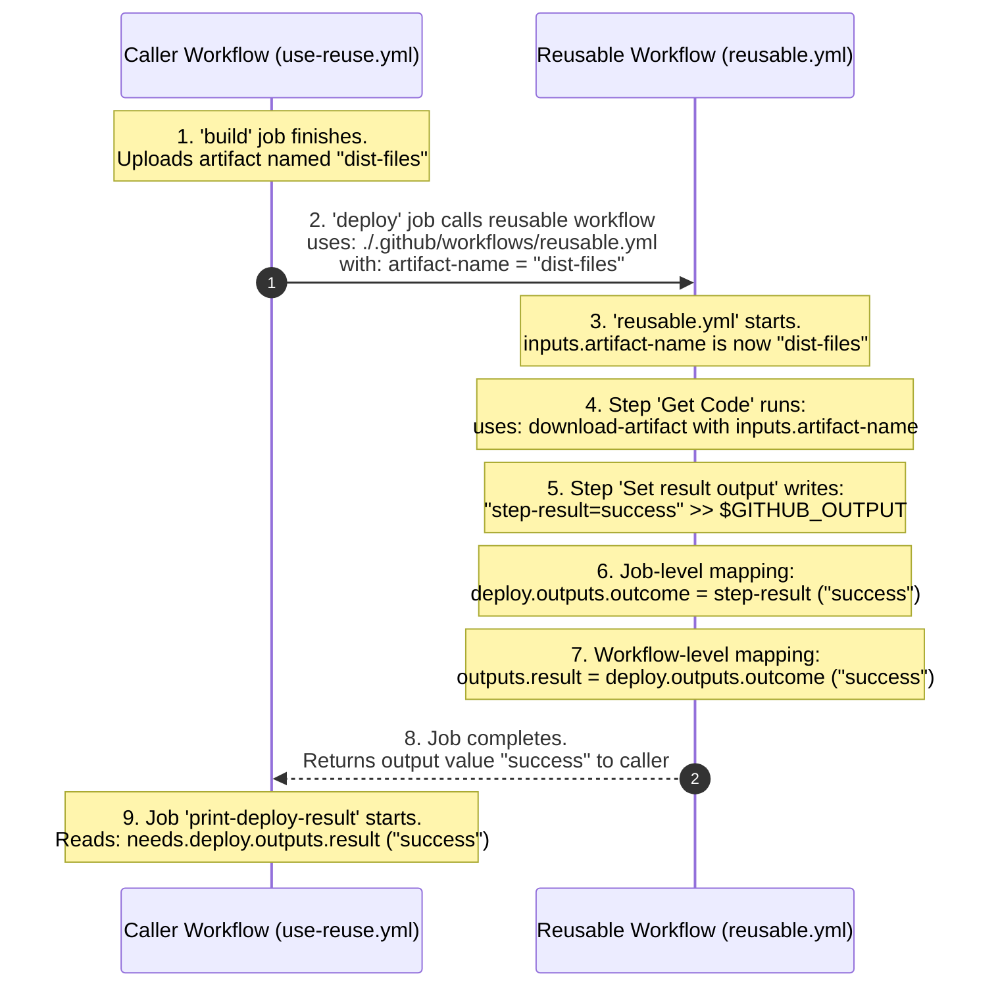
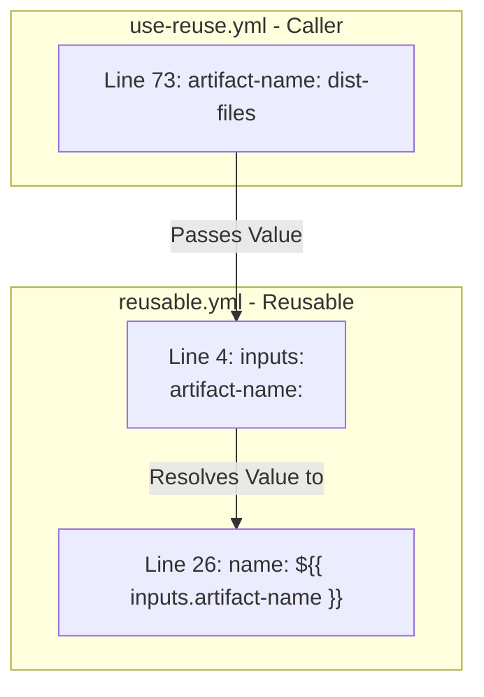
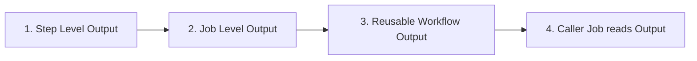

# Reusable Workflows: Step-by-Step Execution and Data Flow

This document details how data and control flow between the **Caller Workflow** ([use-reuse.yml](file:///c:/Users/lenovo/OneDrive/Desktop/github-action/github-actions/Code/06%20Execution%20Flow/02%20Finished%20Project/.github/workflows/use-reuse.yml)) and the **Reusable Workflow** ([reusable.yml](file:///c:/Users/lenovo/OneDrive/Desktop/github-action/github-actions/Code/06%20Execution%20Flow/02%20Finished%20Project/.github/workflows/reusable.yml)).

---

## 🗺️ Visual Architecture (Data Pipeline)

Below is a diagram of how data enters as an **Input** from the caller, gets processed, and exits back to the caller as an **Output**.



---

## 🔍 Line-by-Line Tracing (Line-to-Line Connection)

Let's look at the exact line numbers in both files to trace the data pipeline.

### Part A: Sending Inputs (Caller ➡️ Reusable)



1. **In [use-reuse.yml:L73](file:///c:/Users/lenovo/OneDrive/Desktop/github-action/github-actions/Code/06%20Execution%20Flow/02%20Finished%20Project/.github/workflows/use-reuse.yml#L73)**:
   ```yaml
   uses: ./.github/workflows/reusable.yml
   with:
     artifact-name: dist-files    # <--- [SENDER]
   ```
   * **Intuition**: This is the argument you are sending. You are telling the reusable workflow: *"Hey, use the folder named 'dist-files' for your steps."*

2. **In [reusable.yml:L4-L5](file:///c:/Users/lenovo/OneDrive/Desktop/github-action/github-actions/Code/06%20Execution%20Flow/02%20Finished%20Project/.github/workflows/reusable.yml#L4-L5)**:
   ```yaml
   on: 
     workflow_call:
       inputs:
         artifact-name:           # <--- [RECEIVER]
   ```
   * **Intuition**: The reusable workflow defines a parameter named `artifact-name`. It receives `"dist-files"` and stores it inside `inputs.artifact-name`.

3. **In [reusable.yml:L26](file:///c:/Users/lenovo/OneDrive/Desktop/github-action/github-actions/Code/06%20Execution%20Flow/02%20Finished%20Project/.github/workflows/reusable.yml#L26)**:
   ```yaml
   uses: actions/download-artifact@v3
   with:
     name: ${{ inputs.artifact-name }} # <--- [CONSUMER]
   ```
   * **Intuition**: Inside the runner VM, GitHub Actions resolves `${{ inputs.artifact-name }}` to `"dist-files"`. The step runs `download-artifact` to download the compiled HTML/JS files.

---

### Part B: Returning Outputs (Reusable ➡️ Caller)

Returning data is a 3-step bubble-up process: **Step Output ➡️ Job Output ➡️ Workflow Output ➡️ Caller Job**.



1. **Step Level ([reusable.yml:L31-L33](file:///c:/Users/lenovo/OneDrive/Desktop/github-action/github-actions/Code/06%20Execution%20Flow/02%20Finished%20Project/.github/workflows/reusable.yml#L31-L33))**:
   ```yaml
   - name: Set result output
     id: set-result
     run: echo "step-result=success" >> $GITHUB_OUTPUT
   ```
   * **Intuition**: The step finishes deploying, and writes the status `step-result=success` onto its local notepad (`$GITHUB_OUTPUT`).

2. **Job Level ([reusable.yml:L18-L20](file:///c:/Users/lenovo/OneDrive/Desktop/github-action/github-actions/Code/06%20Execution%20Flow/02%20Finished%20Project/.github/workflows/reusable.yml#L18-L20))**:
   ```yaml
   jobs:
     deploy:
       outputs:
         outcome: ${{ steps.set-result.outputs.step-result }}
   ```
   * **Intuition**: The job takes that local step output (`step-result` from step `set-result`) and saves it at the job level as `outcome` before the runner VM is deleted.

3. **Workflow Level ([reusable.yml:L10-L13](file:///c:/Users/lenovo/OneDrive/Desktop/github-action/github-actions/Code/06%20Execution%20Flow/02%20Finished%20Project/.github/workflows/reusable.yml#L10-L13))**:
   ```yaml
   on:
     workflow_call:
       outputs:
         result:
           value: ${{ jobs.deploy.outputs.outcome }}
   ```
   * **Intuition**: The workflow-level configuration maps its public return output (`result`) to the job-level output (`outcome` from job `deploy`). This sends `"success"` outside this file.

4. **Caller Job reads Output ([use-reuse.yml:L80-L81](file:///c:/Users/lenovo/OneDrive/Desktop/github-action/github-actions/Code/06%20Execution%20Flow/02%20Finished%20Project/.github/workflows/use-reuse.yml#L80-L81))**:
   ```yaml
   print-deploy-result:
     needs: deploy
     runs-on: ubuntu-latest
     steps:
       - name: Print deploy output
         run: echo "${{ needs.deploy.outputs.result }}"
   ```
   * **Intuition**: Because `print-deploy-result` depends on `deploy` (`needs: deploy`), it can access the outputs of `deploy` (which was the reusable workflow call). It reads `needs.deploy.outputs.result` which resolves to `"success"`.
